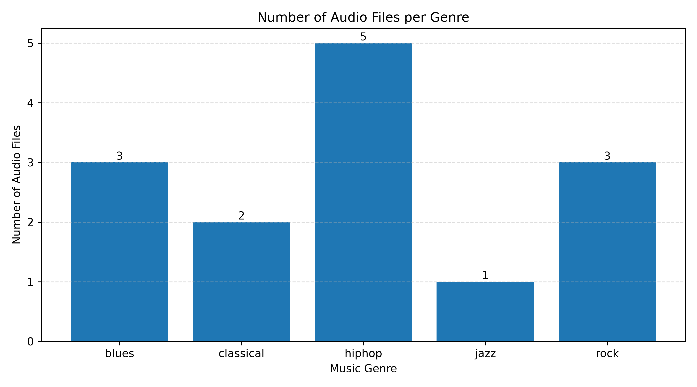
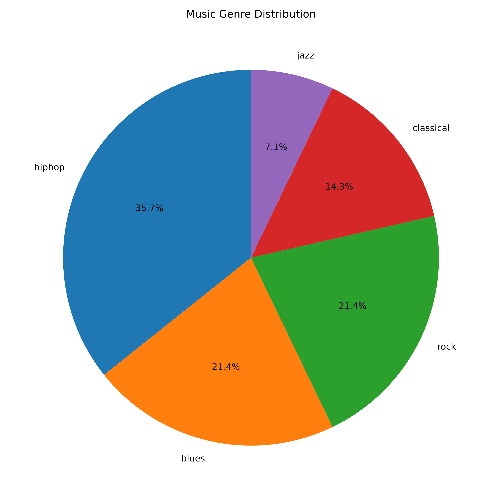
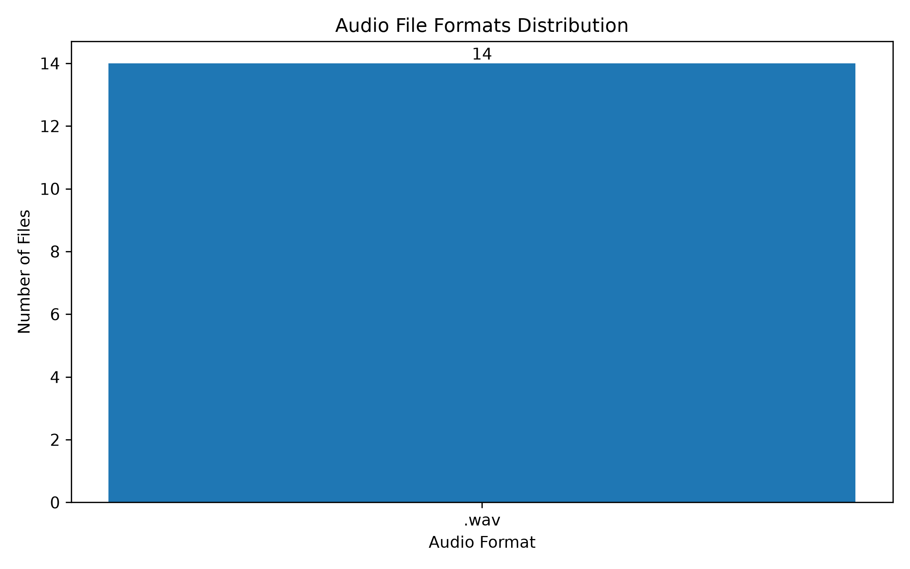
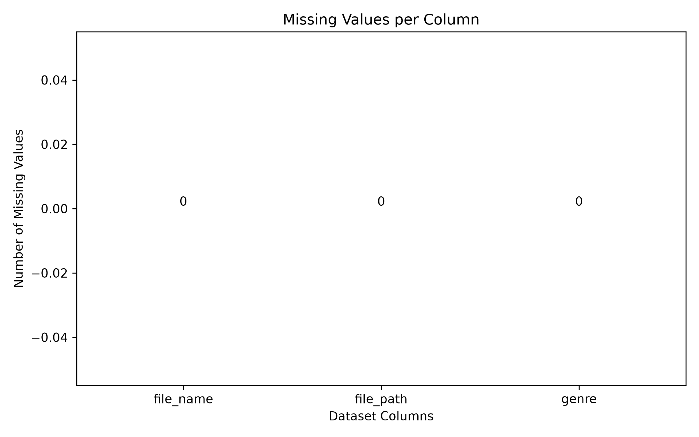

# 🎵 پروژه تشخیص ژانر موسیقی با پایتون

## ۱. معرفی پروژه

هدف این پروژه طراحی یک سیستم برای تشخیص ژانر موسیقی با استفاده از زبان برنامه‌نویسی پایتون و روش‌های یادگیری ماشین است.

در این پروژه، فایل‌های صوتی در ژانرهای مختلف جمع‌آوری و سازمان‌دهی می‌شوند تا در مراحل بعدی، ویژگی‌های صوتی آن‌ها استخراج شده و برای آموزش مدل تشخیص ژانر موسیقی مورد استفاده قرار گیرند.

## ۲. ساختار پروژه

ساختار پوشه‌های پروژه به شکل زیر است:

```text
MusicGenreProject/
│
├── data/
│   ├── genres_original/
│   └── processed/
│       └── metadata.csv
│
├── src/
│   ├── load_data.py
│   └── eda_visualization.py
│
├── reports/
│   └── plots/
│       ├── genre_distribution.png
│       ├── genre_percentage.png
│       ├── audio_formats.png
│       └── missing_values.png
│
├── README.md
└── requirements.txt
```

## ۳. منبع داده‌ها

داده‌های مورد استفاده در این پروژه شامل فایل‌های صوتی مربوط به ژانرهای مختلف موسیقی هستند.

در نسخه فعلی پروژه، ۱۴ فایل صوتی در پنج ژانر مختلف مورد بررسی قرار گرفته‌اند:

- Blues
- Classical
- Hip-hop
- Jazz
- Rock

## ۴. اسکریپت بارگذاری داده‌ها

فایل `load_data.py` وظیفه بارگذاری و شناسایی فایل‌های صوتی را بر عهده دارد.

وظایف این اسکریپت عبارت‌اند از:

- شناسایی پوشه‌های مربوط به ژانرهای موسیقی
- پیدا کردن فایل‌های صوتی
- ثبت نام فایل‌ها
- ثبت مسیر فایل‌ها
- تعیین ژانر هر فایل بر اساس نام پوشه
- ذخیره اطلاعات در فایل CSV

خروجی این مرحله در مسیر زیر ذخیره می‌شود:

`data/processed/metadata.csv`

## ۵. تست و بررسی عملکرد برنامه

برای بررسی صحت عملکرد اسکریپت بارگذاری داده‌ها، برنامه اجرا شد و فایل‌های صوتی موجود در پوشه‌های مختلف با موفقیت شناسایی شدند.

### خروجی واقعی اجرای برنامه

```text
Checking genre: blues
Checking genre: classical
Checking genre: hiphop
Checking genre: jazz
Checking genre: rock

Data loading completed!
Total audio files: 14

Files per genre:
genre
blues        3
classical    2
hiphop       5
jazz         1
rock         3
Name: count, dtype: int64
```

### نتیجه تست

بر اساس خروجی برنامه:

| ژانر موسیقی | تعداد فایل |
|---|---:|
| Blues | 3 |
| Classical | 2 |
| Hip-hop | 5 |
| Jazz | 1 |
| Rock | 3 |
| **مجموع** | **14** |

برنامه توانست تمام ۱۴ فایل صوتی را شناسایی کرده و اطلاعات آن‌ها را با موفقیت جمع‌آوری کند.

## ۶. تحلیل اکتشافی داده‌ها (EDA)

در این مرحله، اطلاعات اولیه دیتاست با استفاده از کتابخانه‌های Pandas و Matplotlib بررسی و تحلیل شده‌اند.

اهداف این مرحله عبارت‌اند از:

- بررسی تعداد فایل‌های صوتی در هر ژانر
- بررسی توزیع ژانرهای موسیقی
- بررسی فرمت فایل‌های صوتی
- شناسایی مقادیر گمشده
- بررسی داده‌های تکراری
- شناخت اولیه ساختار مجموعه داده

### ۶.۱. نمودار تعداد فایل‌های صوتی در هر ژانر

این نمودار تعداد فایل‌های صوتی موجود در هر ژانر را نمایش می‌دهد و امکان مقایسه تعداد نمونه‌های ژانرهای مختلف را فراهم می‌کند.



**تحلیل نمودار:**

همان‌طور که مشاهده می‌شود، ژانر Hip-hop با ۵ فایل بیشترین تعداد نمونه را دارد. ژانر Jazz با یک فایل کمترین تعداد نمونه را به خود اختصاص داده است. همچنین ژانرهای Blues و Rock هرکدام ۳ فایل و ژانر Classical دارای ۲ فایل هستند.

این موضوع نشان می‌دهد که توزیع نمونه‌ها در دیتاست متعادل نیست.

### ۶.۲. نمودار درصد توزیع ژانرهای موسیقی

این نمودار سهم هر ژانر را از کل فایل‌های صوتی موجود در دیتاست نشان می‌دهد.



**تحلیل نمودار:**

بر اساس نمودار، ژانر Hip-hop حدود ۳۵٫۷ درصد از کل داده‌ها را تشکیل می‌دهد و بیشترین سهم را دارد. ژانر Jazz نیز با حدود ۷٫۱ درصد کمترین سهم را به خود اختصاص داده است.

این نمودار دید مناسبی از میزان سهم هر ژانر در مجموعه داده ارائه می‌دهد.

### ۶.۳. نمودار توزیع فرمت فایل‌های صوتی

این نمودار تعداد فایل‌های صوتی را بر اساس فرمت آن‌ها نمایش می‌دهد.



**تحلیل نمودار:**

با استفاده از این نمودار می‌توان فرمت‌های صوتی موجود در دیتاست و تعداد فایل‌های مربوط به هر فرمت را بررسی کرد. این اطلاعات برای شناخت ساختار داده‌ها و آماده‌سازی فایل‌های صوتی در مراحل بعدی مفید هستند.

### ۶.۴. نمودار مقادیر گمشده

این نمودار تعداد مقادیر گمشده در ستون‌های مختلف اطلاعات دیتاست را نمایش می‌دهد.



**تحلیل نمودار:**

با بررسی این نمودار می‌توان وضعیت کامل بودن اطلاعات مربوط به نام فایل، مسیر فایل و ژانر موسیقی را ارزیابی کرد.

در صورت وجود مقادیر گمشده، باید پیش از استفاده از داده‌ها در مراحل بعدی، برای مدیریت آن‌ها تصمیم‌گیری شود.

## ۷. نتیجه‌گیری تحلیل داده‌ها

در این مرحله، تحلیل اکتشافی اولیه روی مجموعه داده موسیقی انجام شد.

نتایج نشان می‌دهند:

- مجموعه داده شامل ۱۴ فایل صوتی است.
- فایل‌ها در پنج ژانر مختلف دسته‌بندی شده‌اند.
- ژانر Hip-hop بیشترین تعداد نمونه را دارد.
- ژانر Jazz کمترین تعداد نمونه را دارد.
- توزیع تعداد نمونه‌ها بین ژانرها نامتعادل است.
- نمودارهای مربوط به فرمت فایل‌ها و مقادیر گمشده برای بررسی کیفیت داده‌ها تهیه شده‌اند.

این تحلیل به شناخت بهتر ساختار دیتاست و شناسایی مشکلات احتمالی آن پیش از ورود به مراحل پردازش صوت و آموزش مدل یادگیری ماشین کمک می‌کند.

## ۸. کتابخانه‌های مورد استفاده

- Python: زبان برنامه‌نویسی پروژه
- Pandas: بارگذاری و مدیریت داده‌ها
- Matplotlib: رسم نمودارها و نمایش تصویری اطلاعات
- Pathlib: مدیریت مسیر فایل‌ها و پوشه‌ها

## ۹. نحوه اجرای پروژه

ابتدا محیط مجازی را ایجاد کنید:

```bash
python -m venv .venv
```

فعال‌سازی محیط مجازی در ویندوز:

```bash
.venv\Scripts\activate
```

نصب کتابخانه‌های مورد نیاز:

```bash
python -m pip install -r requirements.txt
```

اجرای اسکریپت بارگذاری داده‌ها:

```bash
python src/load_data.py
```

اجرای اسکریپت تحلیل و رسم نمودارها:

```bash
python src/eda_visualization.py
```

## ۱۰. وضعیت فعلی پروژه

در نسخه فعلی پروژه، مراحل بارگذاری فایل‌های صوتی، سازمان‌دهی داده‌ها، تهیه اطلاعات اولیه و رسم نمودارهای تحلیل اکتشافی پیاده‌سازی شده‌اند.
